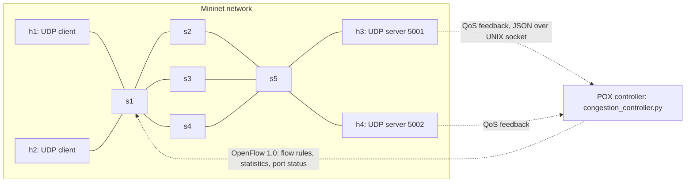
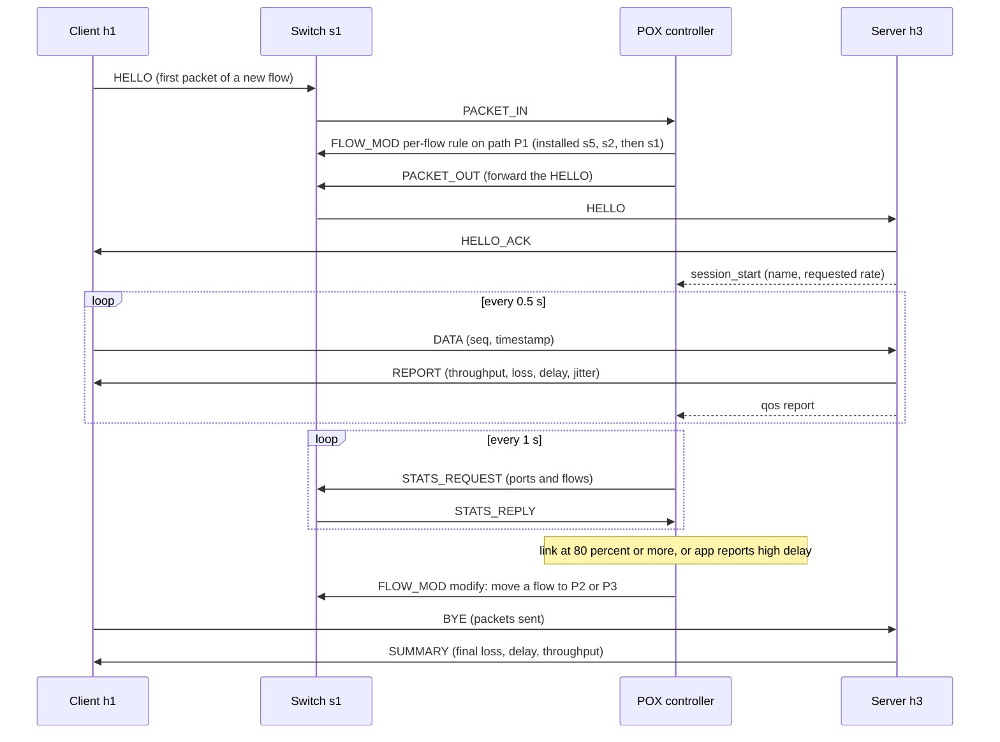
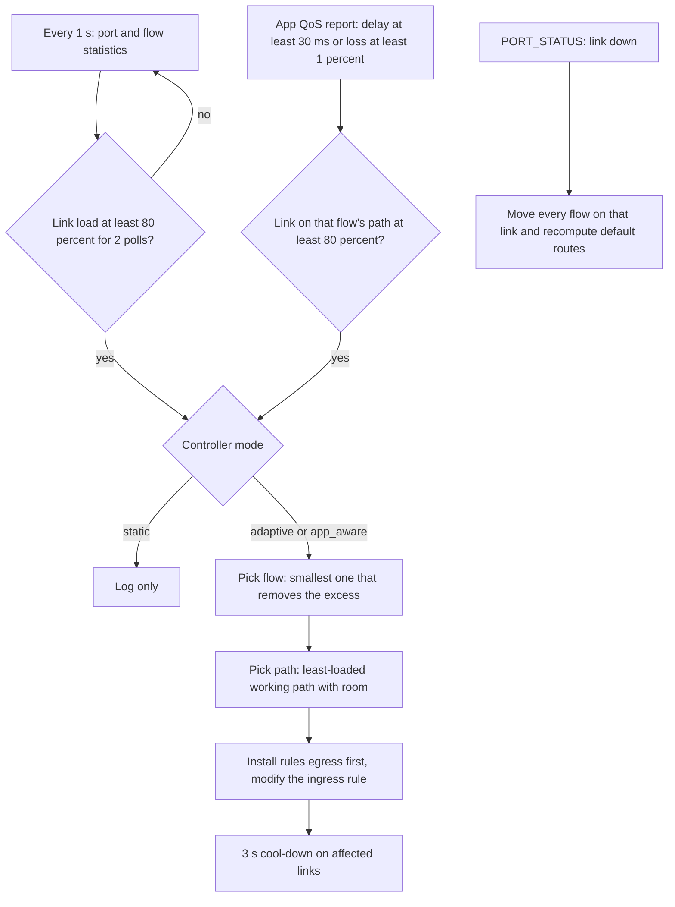
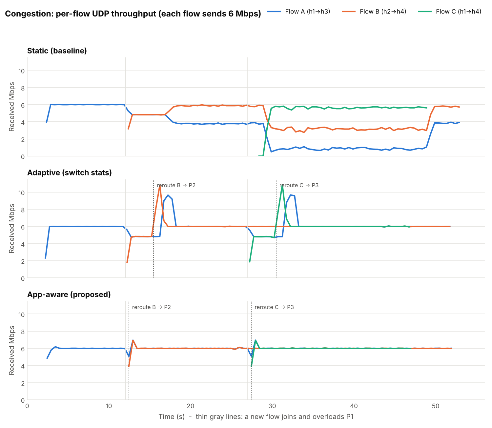
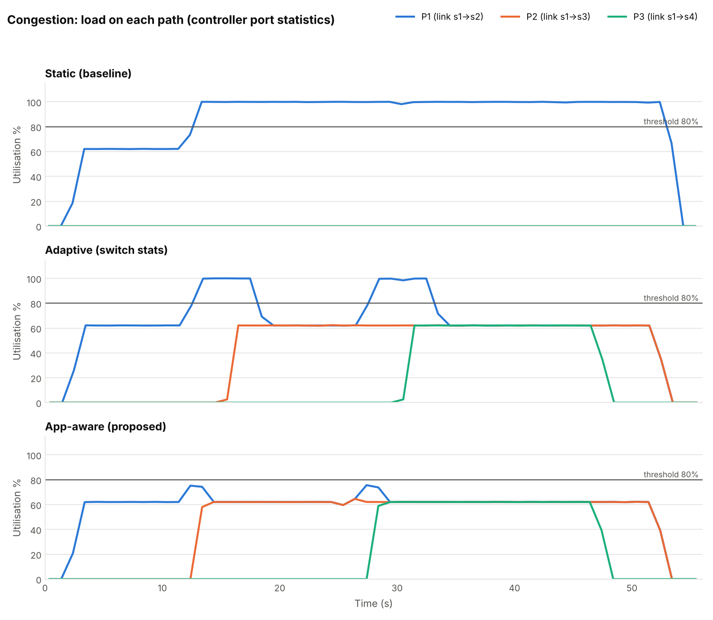
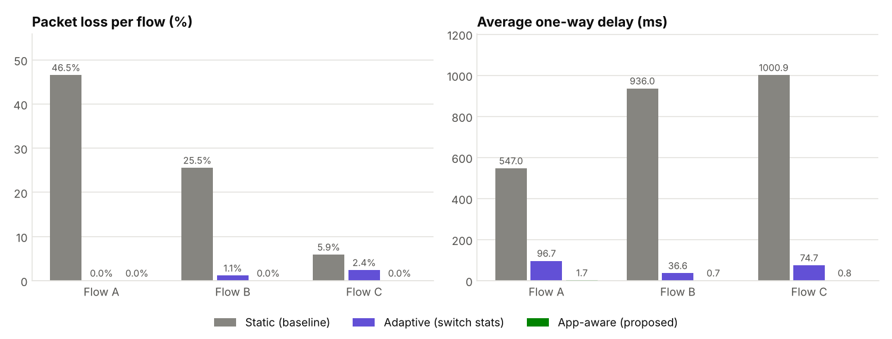
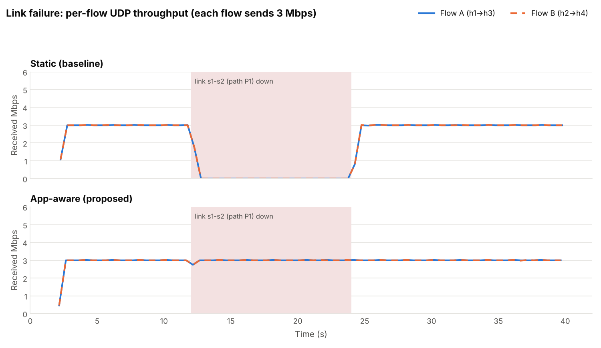
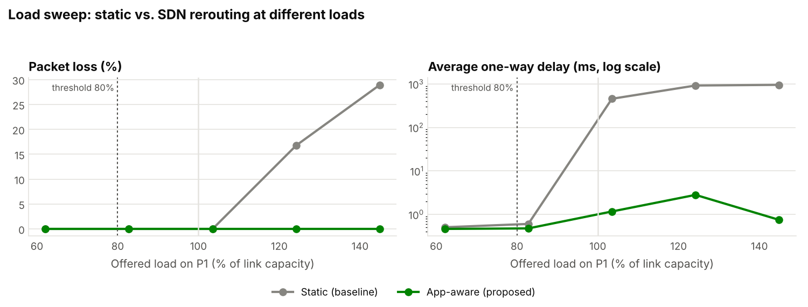

# Congestion Detection and Traffic Rerouting with SDN (UDP)

**SDN–Socket Programming (Jackfruit) Mini Project · Computer Networks (UE25CS243A)**
PES University, Bengaluru · B.Tech CSE · Section H · **Group 3 · Problem 27** · Protocol: **UDP**

| # | Name | USN |
|---|------|-----|
| 1 | Samhita Sagare Venkatesh | PES1UG25CS453 |
| 2 | Sohum Marak | PES1UG26CS850 |
| 3 | Janhavi Chetankumar Bodar | PES1UG26CS821 |

> **Problem statement.** Generate UDP traffic across multiple network paths and develop an SDN controller that detects congestion and dynamically reroutes traffic through a less-loaded path.

**Stack:** Mininet · Open vSwitch · POX controller (OpenFlow 1.0) · Python 3 UDP sockets

| Want to… | Go to |
|---|---|
| Install and run it step by step in Mininet | [docs/INSTALL_AND_RUN.md](docs/INSTALL_AND_RUN.md) |
| Read the application protocol | [docs/PROTOCOL.md](docs/PROTOCOL.md) |
| See the test cases and their results | [tests/TEST_REPORT.md](tests/TEST_REPORT.md) |
| See all measured results | [results/comparison.md](results/comparison.md) |
| Prepare the demo / viva | [docs/DEMO_SCRIPT.md](docs/DEMO_SCRIPT.md) · [docs/VIVA.md](docs/VIVA.md) |

---

## 1. Problem understanding and objectives

UDP has **no congestion control**: a UDP sender keeps sending at its own rate even when the network drops its packets. When several UDP flows share one path, that path's queue fills up, so delay rises to about a second and packets are lost. Meanwhile other paths with spare capacity sit unused, because ordinary routing always picks the same shortest path.

**Objectives**
1. Build a multipath Mininet network where congestion can be created on purpose.
2. Build a UDP client/server application that generates traffic and measures throughput, loss, delay and jitter.
3. Build an SDN controller that **monitors** links and flows, **detects** congestion against a threshold, and **reroutes** flows to the least-loaded path.
4. Connect the application to the controller, so the application's own QoS measurements influence routing.
5. Handle harder situations: link failure, server overload, server restart, bad input.
6. Measure recovery time, throughput, loss and delay, and **compare against static routing** under several conditions.

**Expected network behaviour.** With static routing every flow stays on path P1. Once P1 is overloaded, loss and delay stay high until the traffic stops. With SDN rerouting, the controller notices within a few seconds (or under one second with application feedback), moves a flow to P2 or P3, and every flow gets its full rate back.

## 2. Architecture

### Topology

```
                 +------ s2 ------+          P1 = s1 -> s2 -> s5  (default path)
                 |                |
   h1 --+        |                |        +-- h3  UDP server :5001
 clients+--- s1 -+------ s3 ------+- s5 ---+     P2 = s1 -> s3 -> s5
   h2 --+        |                |        +-- h4  UDP server :5002
                 |                |              P3 = s1 -> s4 -> s5
                 +------ s4 ------+
   core links 10 Mbps (TCLink/HTB)   host links not limited   IPs 10.0.0.1-4
```

### Components



| Component | File | Role |
|---|---|---|
| Topology | `topology.py`, `netconfig.py` | 5 switches, 4 hosts, 3 equal paths, fixed port numbers shared with the controller |
| UDP client | `app/udp_client.py` | Handshake, constant-rate DATA stream, live reports, error handling |
| UDP server | `app/udp_server.py` | Concurrent sessions, per-interval QoS measurement, reports to clients and to the controller |
| Protocol | `app/protocol.py` | Binary message format (8 message types) |
| SDN controller | `controller/congestion_controller.py` | Flow rules, monitoring, congestion detection, rerouting, link-failure recovery |
| Decision logic | `controller/routing_logic.py` | Which flow to move and which path to use (pure functions, unit-tested) |
| Experiments | `experiment.py`, `run_all.sh` | Scenarios: congestion, link failure, load sweep, in 3 controller modes |
| Evaluation | `analyze.py` | Metrics, comparison tables, graphs |
| Tests | `tests/` | 28 unit tests + 12 automated Mininet test cases |

### Communication flow



## 3. UDP socket implementation

A small **application protocol** on top of UDP (full spec: [docs/PROTOCOL.md](docs/PROTOCOL.md)):

- **Message types:** HELLO, HELLO_ACK, REJECT, DATA, REPORT, BYE, SUMMARY, ERROR. All share a 20-byte binary header (magic, version, type, session id, sequence number, timestamp).
- **Client/server:** the client opens a session with HELLO, streams DATA at a constant rate, gets a REPORT every 0.5 s, and closes with BYE/SUMMARY. HELLO and BYE are retried, because UDP may lose them.
- **Concurrency:** one server socket serves many clients. The server's receive thread and reporter thread share a lock-protected session table. The client sends in one thread and receives reports in another. In the experiments, the h4 server handles flows B and C at the same time.
- **Error handling:** server unreachable (ICMP port unreachable through a connected UDP socket), server full (REJECT), malformed datagrams, unknown session after a server restart (the client re-handshakes), send failures during link outages, idle-session timeout, and the controller channel being unavailable.
- **Measurement:** loss from sequence-number gaps, one-way delay from timestamps (Mininet hosts share one clock), and RFC 3550 jitter. Each session is written to `flow_<name>.csv`.

## 4. Mininet + SDN implementation

Rules the controller installs:

| Priority | Match | Action | Purpose |
|---|---|---|---|
| 300 | UDP: src IP, dst IP, src port, dst port | output to the next switch on the chosen path | One rule per flow, so each flow can be rerouted on its own |
| 200 | ARP | controller | Proxy ARP: the controller answers, so no broadcast loops around the 3 paths |
| 200 | UDP from a host port (edge switches) | controller | The first packet of a new flow reaches the controller |
| 100 | destination IP | default (shortest working) path | ping and other traffic |
| 0 | everything else | drop | No flooding in a looped topology |

Controller **modes** (`--mode`):

| Mode | Behaviour |
|---|---|
| `static` | **Baseline.** Flows stay on P1. Congestion and link failures are only logged |
| `adaptive` | Rerouting driven by OpenFlow port and flow statistics, plus link-failure recovery |
| `app_aware` | **Proposed.** `adaptive` + QoS feedback and flow demand from the UDP application |

## 5. Socket–SDN integration

The application and the network affect each other in both directions:

1. **Application → flow rules.** Every client socket is its own flow (its 4-tuple). The first packet of a session (HELLO) triggers PACKET_IN, and the controller installs a rule for exactly that flow. A session is the unit the controller monitors and moves.
2. **Application → controller decisions.** The UDP server sends JSON messages over a UNIX datagram socket (`/tmp/sdn_app_feedback.sock`): `session_start` (with the requested rate), a `qos` report every 0.5 s, and `session_end`. In `app_aware` mode:
   - a report with **delay ≥ 30 ms or loss ≥ 1%** on a flow whose path has a link at 80% or more triggers rerouting immediately, without waiting for two statistics polls;
   - the requested rate tells the controller how big a new flow is before switch counters can measure it.
3. **Network → application.** The application sees the effect directly: its delay and loss drop right after a reroute. The server's REPORTs show this to each client live.

The controller writes `APP_SESSION_START`, `APP_QOS_ALERT` and `APP_QOS_OK` events and `app_qos.csv`, so the integration is visible in the logs (test case TC11).

## 6. Dynamic SDN functionality



- **Monitoring:** port statistics give each link's load from the change in `tx_bytes`. Flow statistics give each flow's rate at the ingress switch. Load = max(measured port rate, sum of the flow rates routed over the link).
- **Detection:** threshold 80% of capacity for 2 consecutive polls (port statistics), or one QoS alert from the application (`app_aware`).
- **Rerouting:** move the smallest flow that removes the excess, to the least-loaded working path that keeps it under 80%. Rules are installed **make-before-break**, and `MODIFY_STRICT` keeps the counters.
- **Stability:** cool-down on the old and new path's links, a 10 s hold per flow, and clearing only below 70%.
- **Recovery:** on a link-down PORT_STATUS, every affected flow is moved at once and the default routes are recomputed.

## 7. Challenging scenarios / robustness

| Scenario | How it is created | What the system does | Shown in |
|---|---|---|---|
| **Congestion** | 2–3 flows of 6 Mbps on a 10 Mbps path | Detects it and moves a flow to P2, then the next to P3 | `experiment.py --scenario congestion`, TC08 |
| **Link failure** | `link s1 s2 down` / `configLinkStatus` | Moves flows within milliseconds; ping keeps working | `--scenario linkfail`, TC10 |
| **Server overload** | `--max-sessions 2`, 3 clients | Third client gets REJECT and exits cleanly | TC05 |
| **Service failure** | Server killed and restarted mid-stream | Client detects the unknown session, re-handshakes and continues | TC12 |
| **Bad input** | Non-protocol datagram, no server listening | Ignored and counted; client reports "unreachable" | TC06 |

## 8. Performance evaluation and comparison

**Metrics:** throughput, packet loss, one-way delay, jitter, detection time, reroute time, recovery time.
**Baseline:** static routing. **Conditions:** (1) congestion with 3 flows, (2) link failure, (3) load sweep with offered load on P1 from 62% to 145% of capacity.

**Key findings (our run)**
- **Congestion:** static routing lost **32%** of packets, with about 1 s of queueing delay. Adaptive rerouting cut loss to **0.85%** (detection after 3.5 s). App-aware rerouting reached **0% loss** and under 2 ms average delay, because the application's delay report triggered the reroute after **0.5 s**.
- **Link failure:** static lost **97%** of packets for the 12 s outage. The controller moved both flows **3 ms** after the PORT_STATUS message, with **0.36%** loss.
- **Load sweep:** static routing breaks down above 100% load (delay about 0.5–1 s, then 17–29% loss). SDN rerouting keeps **0% loss** and under 3 ms delay at every load up to 145%.

*Environment: Mininet 2.3, Open vSwitch 3.3 (userspace datapath), POX 0.7.0, Python 3.13, 2-CPU VM. Re-running `sudo ./run_all.sh` on your VM gives slightly different numbers but the same picture.*

<!--RESULTS-->
### 8.1. Congestion (3 flows of 6 Mbps, 10 Mbps links)

- Flow A: h1 -> h3, 6 Mbps, t = 2-52 s
- Flow B: h2 -> h4, 6 Mbps, t = 12-52 s
- Flow C: h1 -> h4, 6 Mbps, t = 27-47 s

| Flow | Mode | Avg throughput (Mbps) | Loss | Avg delay (ms) | Max delay (ms) | Jitter (ms) |
|---|---|---|---|---|---|---|
| A | Static (baseline) | 3.14 of 6 | 46.54 % | 547.0 | 1015.6 | 0.40 |
| A | Adaptive (switch stats) | 6.00 of 6 | 0.00 % | 96.7 | 785.6 | 0.21 |
| A | App-aware (proposed) | 6.00 of 6 | 0.00 % | 1.7 | 35.1 | 0.14 |
| B | Static (baseline) | 4.36 of 6 | 25.54 % | 936.0 | 1015.5 | 0.44 |
| B | Adaptive (switch stats) | 6.01 of 6 | 1.14 % | 36.6 | 577.8 | 17.54 |
| B | App-aware (proposed) | 6.01 of 6 | 0.00 % | 0.7 | 12.6 | 0.14 |
| C | Static (baseline) | 5.29 of 6 | 5.90 % | 1000.9 | 1015.3 | 0.49 |
| C | Adaptive (switch stats) | 6.01 of 6 | 2.39 % | 74.7 | 584.8 | 36.77 |
| C | App-aware (proposed) | 6.02 of 6 | 0.00 % | 0.8 | 12.2 | 0.15 |

| Mode | Packets delivered | Packets lost | Overall loss |
|---|---|---|---|
| Static (baseline) | 44617 | 20920 | 31.92 % |
| Adaptive (switch stats) | 67856 | 584 | 0.85 % |
| App-aware (proposed) | 67907 | 0 | 0.00 % |

| Event | Mode | Detected after | Detected by | Rerouted after | Recovered within | Action |
|---|---|---|---|---|---|---|
| flow B joins (t=12s) | Static (baseline) | 3.4 s | port-stats | - | not within 15 s | none |
| flow B joins (t=12s) | Adaptive (switch stats) | 3.5 s | port-stats | 3.5 s | 4.7 s | flow B P1 -> P2 |
| flow B joins (t=12s) | App-aware (proposed) | 0.5 s | application | 0.5 s | 0.9 s | flow B P1 -> P2 |
| flow C joins (t=27s) | Static (baseline) | already congested | - | - | not within 25 s | none |
| flow C joins (t=27s) | Adaptive (switch stats) | 3.5 s | port-stats | 3.5 s | 4.7 s | flow C P1 -> P3 |
| flow C joins (t=27s) | App-aware (proposed) | 0.5 s | application | 0.5 s | 0.9 s | flow C P1 -> P3 |







### 8.2. Link failure (link s1-s2 of path P1 fails at t=12s, repaired at t=24s)

Two 3 Mbps flows (A: h1->h3, B: h2->h4) run on P1 when the link fails.

| Mode | Loss during failure | Overall loss | Reaction (LINK_DOWN -> REROUTED) | Recovered within | Action |
|---|---|---|---|---|---|
| Static (baseline) | 96.59 % | 32.20 % | - | only when the link is repaired | none (flows stay on the failed path) |
| App-aware (proposed) | 0.36 % | 0.12 % | 3 ms | 0.7 s | A -> P3, B -> P2 |



### 8.3. Load sweep (2 flows on P1; offered load = both flows together)

| Per-flow rate | Offered load on P1 | Mode | Loss | Avg delay (ms) | Avg throughput per flow (Mbps) | Reroutes |
|---|---|---|---|---|---|---|
| 3 Mbps | 62 % | Static (baseline) | 0.00 % | 0.5 | 3.00 | 0 |
| 3 Mbps | 62 % | App-aware (proposed) | 0.00 % | 0.5 | 3.00 | 0 |
| 4 Mbps | 83 % | Static (baseline) | 0.00 % | 0.6 | 4.00 | 0 |
| 4 Mbps | 83 % | App-aware (proposed) | 0.00 % | 0.5 | 4.00 | 1 |
| 5 Mbps | 103 % | Static (baseline) | 0.00 % | 457.1 | 4.82 | 0 |
| 5 Mbps | 103 % | App-aware (proposed) | 0.00 % | 1.2 | 5.00 | 1 |
| 6 Mbps | 124 % | Static (baseline) | 16.78 % | 922.4 | 4.81 | 0 |
| 6 Mbps | 124 % | App-aware (proposed) | 0.00 % | 2.8 | 6.04 | 1 |
| 7 Mbps | 145 % | Static (baseline) | 28.95 % | 956.1 | 4.80 | 0 |
| 7 Mbps | 145 % | App-aware (proposed) | 0.00 % | 0.7 | 7.01 | 1 |



<!--/RESULTS-->

## 9. Test cases

`python3 -m unittest discover -s tests` runs **28 unit tests** (protocol encoding and malformed input, flow and path selection, topology consistency). They need no Mininet.

`sudo python3 tests/run_tests.py` runs **12 functional test cases** in Mininet, each with a fresh network and controller:

<!--TESTS-->
**12 of 12 test cases passed.**

| ID | Test case | Rubric area | Controller mode | Result | Observed |
|---|---|---|---|---|---|
| TC01 | Topology and connectivity (pingall) | Mininet + SDN | app_aware | PASS | pingall loss 0%, 5 switches, 4 hosts, 3 paths s1->s5 |
| TC02 | Controller installs base flow rules | Mininet + SDN | app_aware | PASS | s1: 4 default routes, ARP->ctrl 1, UDP->ctrl 2, drop yes; s3: 4 default routes, ARP->ctrl 1, UDP->ctrl 0, drop yes; s5: 4 default routes, ARP->ctrl 1, UDP->ctrl 2, drop yes |
| TC03 | UDP client-server session (HELLO/DATA/BYE) | Socket implementation | app_aware | PASS | client exit 0, handshake ok, SUMMARY loss 0.0%, server CSV written |
| TC04 | Concurrent clients on one server | Socket implementation | app_aware | PASS | 3 clients -> one server: exit codes [0, 0, 0], losses [0.0, 0.0, 0.0] %, server had 3 sessions at once: True |
| TC05 | Server overload: extra client rejected | Robustness | app_aware | PASS | max 2 sessions: clients 1-2 exit 0/0, client 3 exit 3 (REJECTED) |
| TC06 | Error handling: no server / malformed packet | Socket implementation | app_aware | PASS | no server -> client exit 2 (unreachable detected); malformed datagram ignored by server; next client exit 0 |
| TC07 | Per-flow rule installed on default path P1 | Socket-SDN integration | app_aware | PASS | per-flow rule on s1: found, output port 3 (P1 = port 3) |
| TC08 | Congestion detected and flow rerouted | Dynamic SDN | app_aware | PASS | detected True, rerouted h2:40002->h4:5002(B) after 0.6s (P2 (via s3)), loss A 0.0% B 0.0%, flows use ports [3, 4] |
| TC09 | Static baseline: congestion, no rerouting | Performance baseline | static | PASS | static: detected True, rerouted False, loss A 1.21% B 23.0% (expected clear loss because nothing is rerouted) |
| TC10 | Link failure: flows moved, ping still works | Robustness | app_aware | PASS | LINK_DOWN True, flows moved 2 (P2 (via s3)), client loss 0.4%, ping during failure 0% loss |
| TC11 | Application QoS feedback reaches controller | Socket-SDN integration | app_aware | PASS | controller got session start True, 8 QoS reports, session end True, flow labelled with app name True |
| TC12 | Service failure: server restart, client recovers | Robustness | app_aware | PASS | server killed for 2 s: client exit 0, re-handshake True, new server took the session True |
<!--/TESTS-->

## 10. How to run

Full step-by-step guide, matching the course's Mininet installation manual: **[docs/INSTALL_AND_RUN.md](docs/INSTALL_AND_RUN.md)**.

```bash
# one-time setup (Ubuntu VM)
sudo apt update && sudo apt install -y mininet openvswitch-switch git python3-matplotlib
git clone https://github.com/noxrepo/pox.git ~/pox

# live demo: two terminals
./run_controller.sh app_aware                # terminal 1
sudo python3 topology.py                     # terminal 2  -> mininet> CLI (one command at a time)

# reproduce all results and graphs
sudo ./run_all.sh                            # about 12 min (--quick: about 4 min)
sudo python3 tests/run_tests.py              # about 4 min
```

## 11. Rubric mapping

| Deliverable | Component (marks) | Where it is addressed |
|---|---|---|
| D1 | Problem Understanding & Architecture (2) | §1, §2: objectives, topology, component and sequence diagrams |
| D1 | TCP/UDP Socket Implementation (4) | §3, `app/`, [PROTOCOL.md](docs/PROTOCOL.md); TC03, TC04, TC06; 14 protocol unit tests |
| D1 | Mininet + SDN Implementation (4) | §4, `topology.py`, `controller/`; TC01, TC02, TC07 |
| D1 | Socket–SDN Integration (3) | §5: per-session flow rules, application QoS feedback channel; TC07, TC11 |
| D1 | Initial Testing & Demo (2) | §9, [TEST_REPORT.md](tests/TEST_REPORT.md), [DEMO_SCRIPT.md](docs/DEMO_SCRIPT.md) |
| D2 | Complete Application Functionality (4) | Multiple clients and servers, concurrent sessions, full session life cycle |
| D2 | Dynamic SDN Functionality (6) | §6: monitoring, threshold detection, rerouting, load balancing, link-failure recovery |
| D2 | Challenging Scenario / Robustness (4) | §7: congestion, link failure, server overload, service failure, bad input |
| D2 | Performance Evaluation & Comparison (5) | §8: 7 metrics, 3 conditions, static baseline vs 2 SDN modes, [comparison.md](results/comparison.md) |
| D2 | Documentation, Final Demo & Viva (6) | This README, `docs/`, reproducible scripts, [VIVA.md](docs/VIVA.md) |

## 12. Repository structure

```
CN_Group3_Congestion_Rerouting/
├── README.md                    this file
├── netconfig.py                 topology description shared by Mininet and the controller
├── topology.py                  Mininet topology + interactive CLI
├── app/
│   ├── protocol.py              application protocol (message formats)
│   ├── udp_server.py            concurrent UDP server (+ feedback to the controller)
│   └── udp_client.py            UDP streaming client
├── controller/
│   ├── congestion_controller.py POX controller
│   └── routing_logic.py         flow/path selection (unit-tested)
├── experiment.py                one experiment (starts its own controller)
├── run_all.sh                   all experiments + analysis
├── run_controller.sh            controller for the live demo
├── analyze.py                   metrics, tables, graphs
├── tests/
│   ├── test_protocol.py         unit tests
│   ├── test_routing_logic.py    unit tests
│   ├── run_tests.py             12 Mininet test cases
│   └── TEST_REPORT.md           latest test results
├── results/                     measured results (comparison.md, *.png, raw logs)
└── docs/                        INSTALL_AND_RUN, PROTOCOL, DEMO_SCRIPT, VIVA
```

### Publishing to GitHub

```bash
cd CN_Group3_Congestion_Rerouting
git init
git add .
git commit -m "SDN congestion detection and UDP traffic rerouting - Group 3"
git branch -M main
git remote add origin https://github.com/<your-username>/CN_Group3_Congestion_Rerouting.git
git push -u origin main
```
Create the empty repository on github.com first, and add your teammates as collaborators (Settings → Collaborators).

## 13. Limitations and future work

- Statistics are polled every 1 s, so detection from switch counters alone takes 2–3 s. The application feedback reduces this.
- The topology is described in `netconfig.py`; LLDP-based discovery (`openflow.discovery`) would make it generic.
- A whole flow is moved; one flow is never split over several paths. There is a single controller.
- Future work: OpenFlow 1.3 meters and group tables (fast failover), sFlow sampling, placing new flows on the least-loaded path at admission.

## References

1. Mininet: <https://mininet.org/overview/>, <https://mininet.org/walkthrough/>
2. POX controller: <https://github.com/noxrepo/pox>
3. OpenFlow Switch Specification 1.0.0 (Open Networking Foundation)
4. RFC 768 (UDP), RFC 3550 (RTP – interarrival jitter)
