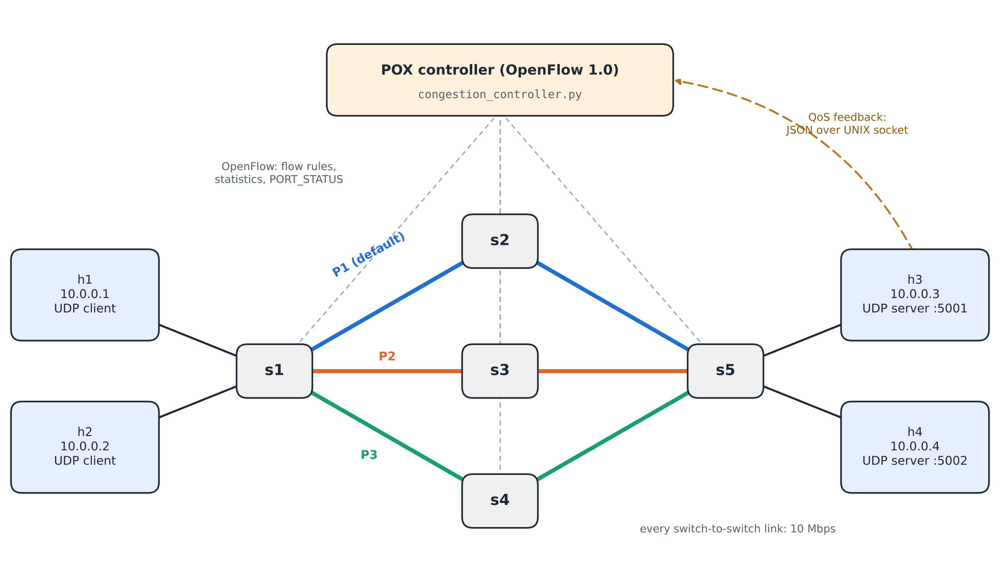
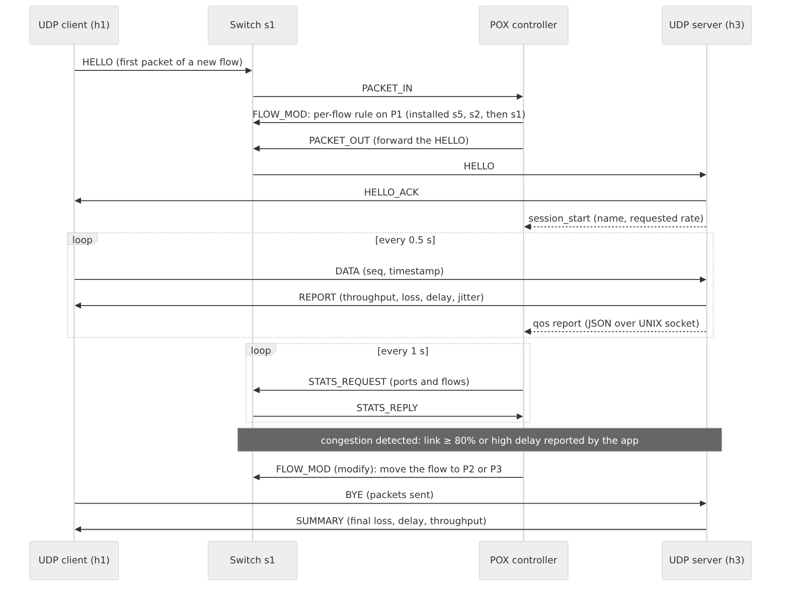
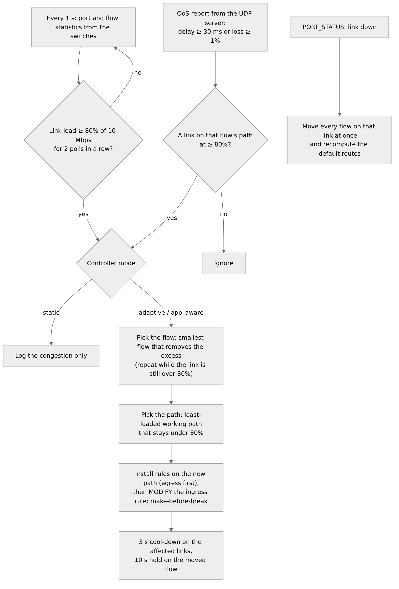
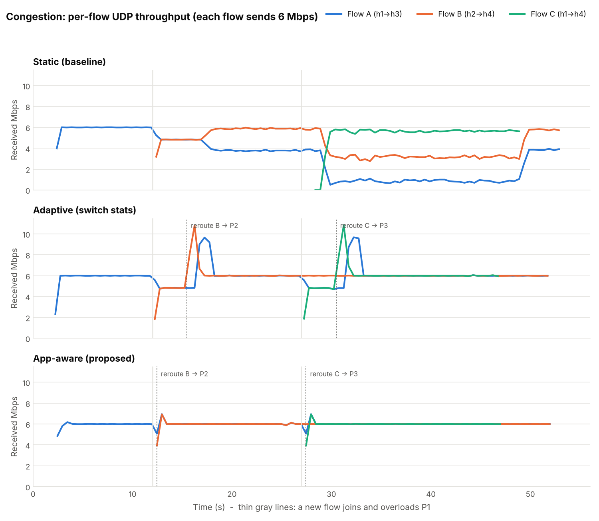
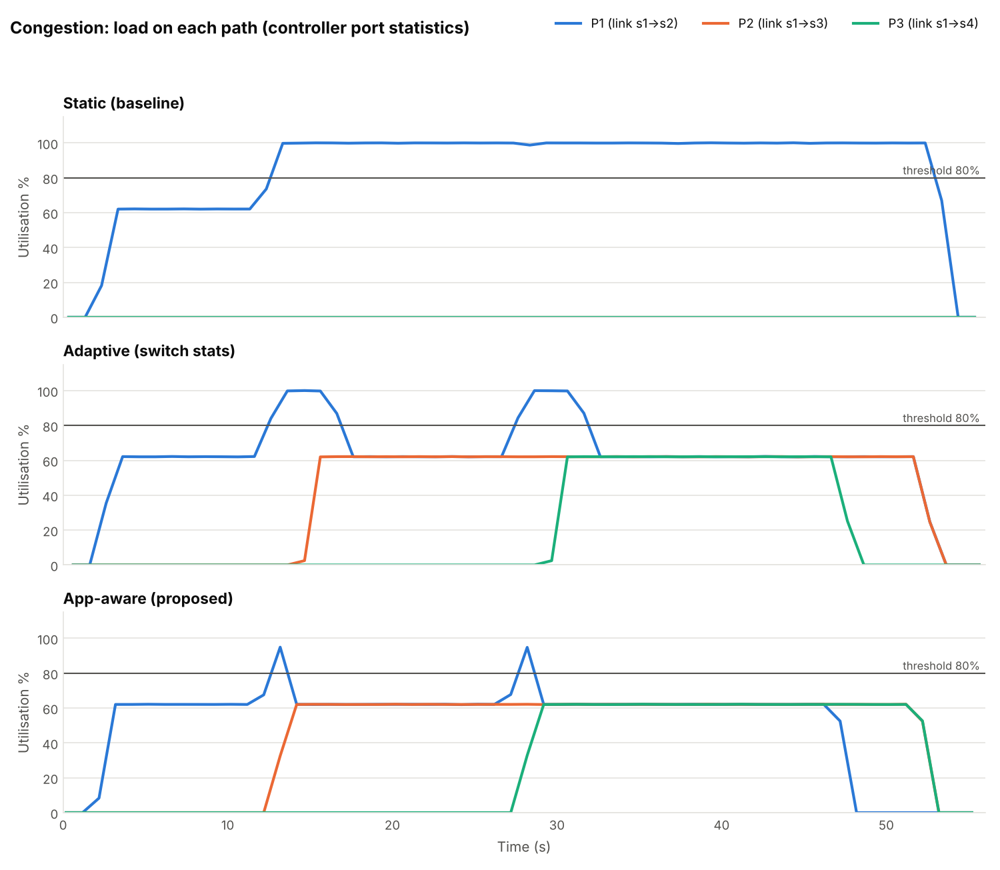
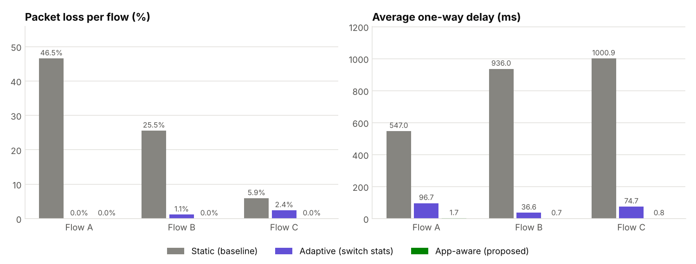
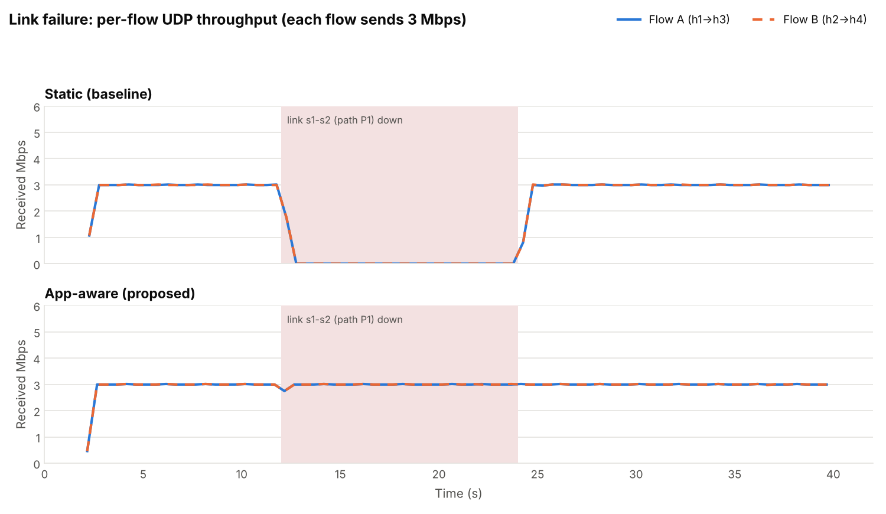
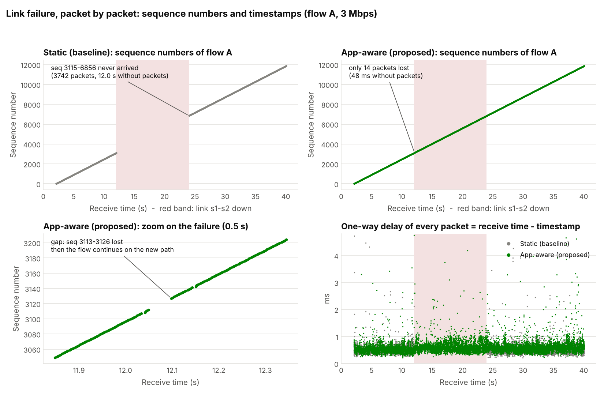
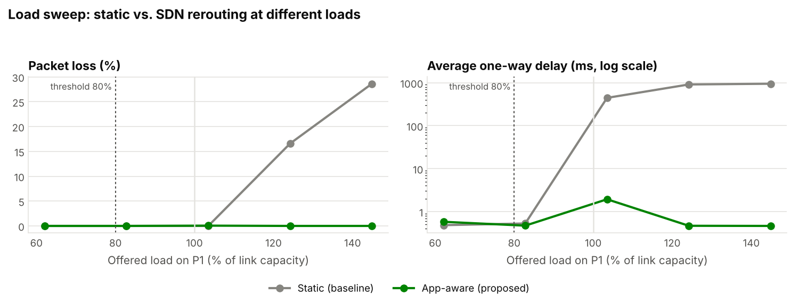
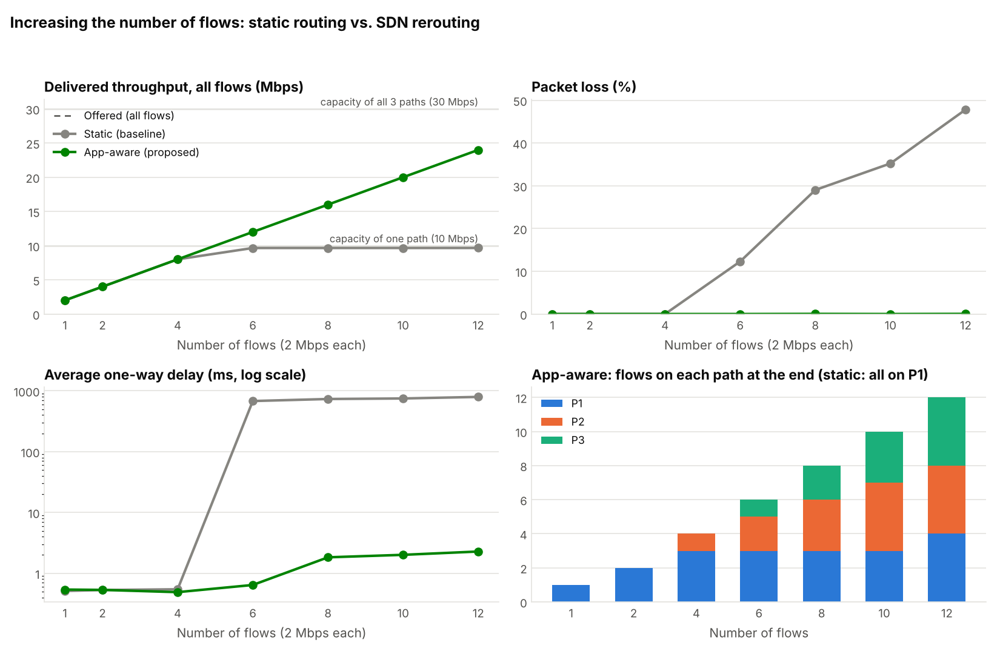

# Congestion Detection and Traffic Rerouting using SDN and UDP Sockets

**Project Report · SDN–Socket Programming (Jackfruit) Mini Project**
**Computer Networks (UE25CS243A) · PES University, Bengaluru**
B.Tech Computer Science and Engineering · Section H · **Group 3 · Problem 27** · Protocol: **UDP**

| # | Name | USN |
|---|------|-----|
| 1 | Samhita Sagare Venkatesh | PES1UG25CS453 |
| 2 | Sohum Marak | PES1UG26CS850 |
| 3 | Janhavi Chetankumar Bodar | PES1UG26CS821 |

Repository: <https://github.com/Soo-hum/CN_Group3_Congestion_Rerouting> · November 2026

<!-- END-TITLE -->

## Abstract

UDP has no congestion control: a UDP sender keeps transmitting at its own rate even when the network is dropping its packets. When several UDP flows are routed over the same path, that path's queue fills, delay rises to about a second and packets are lost, while other paths with spare capacity remain unused. This project builds a complete system that detects such congestion and removes it by rerouting traffic with Software-Defined Networking (SDN).

The system has three parts: (1) a Mininet network with three parallel 10 Mbps paths between two edge switches; (2) a UDP client/server application with its own binary protocol, which streams traffic at a constant rate and measures throughput, loss, one-way delay and jitter using a sequence number and a timestamp in every packet; and (3) a POX OpenFlow controller that installs one rule per application flow, polls switch statistics every second, detects links loaded above 80% of capacity and moves flows to the least-loaded path without interrupting them. In the proposed *application-aware* mode the UDP server also reports its measured quality of service to the controller over a UNIX socket, so congestion is detected from the application's point of view before switch counters can show it.

The system was evaluated against static routing under four conditions: congestion with three flows, a link failure, a load sweep from 62% to 145% of a path's capacity, and an increasing number of flows from 1 to 12. Under congestion, static routing lost 30% of all packets with about one second of queueing delay; switch-statistics rerouting cut loss to 0.73%, and application-aware rerouting removed it completely (0.00%), detecting congestion in 0.7 s instead of 2.6 s. After a link failure, flows were moved 3 ms after the switch reported the failure and only 14 packets per flow were lost, compared with 3,742 under static routing. With 12 flows, static routing delivered at most 9.66 Mbps and lost 48% of packets, whereas the controller spread the flows evenly over the three paths and delivered all 24 Mbps with a Jain fairness index of 1.0. All 14 automated Mininet test cases and 39 unit tests pass.

**Keywords:** Software-Defined Networking, OpenFlow, POX, Mininet, UDP socket programming, congestion detection, traffic engineering, rerouting, quality of service.

## Contents

1. [Introduction](#1-introduction)
2. [Background](#2-background)
3. [System design](#3-system-design)
4. [Implementation](#4-implementation)
5. [Experimental methodology](#5-experimental-methodology)
6. [Results and analysis](#6-results-and-analysis)
7. [Testing and validation](#7-testing-and-validation)
8. [Robustness and challenging scenarios](#8-robustness-and-challenging-scenarios)
9. [Limitations and future work](#9-limitations-and-future-work)
10. [Conclusion](#10-conclusion)
11. [How to reproduce the results](#11-how-to-reproduce-the-results)
12. [References](#12-references)
13. [Appendix A: Repository structure](#appendix-a-repository-structure)
14. [Appendix B: Rubric mapping](#appendix-b-rubric-mapping)

## 1. Introduction

### 1.1 Background and motivation

Many real-time applications, such as video streaming, online games, voice calls and sensor telemetry, use UDP because it adds no connection set-up, no retransmission and no rate control. That makes UDP fast, but it also means that UDP flows do not slow down when the network is overloaded. If more UDP traffic is sent over a link than the link can carry, the excess first waits in the switch's queue (so delay grows) and, once the queue is full, is dropped (so packets are lost).

Traditional networks route traffic along a fixed shortest path. If several flows happen to share that path, it becomes congested even when other paths between the same endpoints are almost idle. Fixing this requires a component that can see the load on every path and change where individual flows are sent, while the flows are running.

Software-Defined Networking provides exactly that. The forwarding decisions of all switches are made by a central, programmable controller that can read traffic counters from every switch and install or change forwarding rules at any time. This project uses SDN to detect congestion caused by UDP traffic and to reroute that traffic through less-loaded paths.

### 1.2 Problem statement

> Generate UDP traffic across multiple network paths and develop an SDN controller that detects congestion and dynamically reroutes traffic through a less-loaded path.

The project expectations listed for Problem 27 are: generate UDP traffic across multiple paths, create controlled congestion, monitor flow statistics, define congestion thresholds, detect overloaded paths, dynamically reroute traffic, measure recovery time and throughput, and compare static and adaptive routing.

### 1.3 Objectives

1. Build a multipath Mininet network in which congestion can be created on purpose and in a repeatable way.
2. Build a UDP client/server application, using low-level socket calls, that generates traffic and measures throughput, loss, delay and jitter.
3. Build an SDN controller that **monitors** links and flows, **detects** congestion against a threshold, and **reroutes** flows to the least-loaded path.
4. Connect the application and the controller, so that the application's own quality-of-service measurements influence routing decisions.
5. Handle harder situations correctly: link failure, many simultaneous flows, server overload, server restart and malformed input.
6. Measure detection time, recovery time, throughput, loss, delay and fairness, and **compare the proposed approach with static routing** under several conditions.

### 1.4 Scope

The work is carried out entirely in an emulated network (Mininet with Open vSwitch) on a single Ubuntu virtual machine, controlled by POX using OpenFlow 1.0. Traffic is constant-bit-rate UDP generated by the project's own application. Whole flows are moved between paths; a single flow is never split over several paths.

### 1.5 Organisation of this report

Section 2 summarises the technologies used. Section 3 describes the design of the network, the application and the controller, and Section 4 their implementation. Section 5 explains how the experiments were run and Section 6 presents and analyses the results. Section 7 covers testing, Section 8 the robustness scenarios, and Sections 9 and 10 the limitations and conclusions. Section 11 explains how to reproduce every result.

## 2. Background

### 2.1 Software-Defined Networking and OpenFlow

SDN separates the **control plane** (deciding where traffic should go) from the **data plane** (forwarding packets). Switches keep only a flow table; a logically central controller programs those tables through a standard protocol. OpenFlow 1.0 [3] is that protocol in this project. The messages used are:

| OpenFlow message | Direction | Use in this project |
|---|---|---|
| `PACKET_IN` | switch → controller | The first packet of a new UDP flow (the session's HELLO) reaches the controller |
| `FLOW_MOD` (add / modify / delete) | controller → switch | Install, change and remove per-flow and default rules |
| `PACKET_OUT` | controller → switch | Forward the packet that caused a `PACKET_IN`; answer ARP requests |
| `STATS_REQUEST` / `STATS_REPLY` (port, flow) | both | Read byte counters of every port and of every per-flow rule, once per second |
| `PORT_STATUS` | switch → controller | A link went down or came back |

Each flow-table entry has a **match** (header fields), a **priority** and a list of **actions** (for example, output to a port). The most specific, highest-priority rule wins, which lets the controller place one rule per application flow above general default routes.

### 2.2 Mininet, Open vSwitch and POX

**Mininet** [1] emulates a whole network on one Linux machine: every host is a separate network namespace with its own interfaces and IP stack, and links are virtual Ethernet pairs. Links can be rate-limited with Linux traffic control (`TCLink`, HTB), which is how the 10 Mbps bottleneck links are created. **Open vSwitch** provides the OpenFlow switches. **POX** [2] is a Python OpenFlow controller platform; the project's controller is a POX component.

### 2.3 UDP and congestion

UDP (RFC 768 [4]) is a connectionless, unreliable datagram service with an 8-byte header. It has no acknowledgements and no congestion control, so the application decides its own sending rate. Two things therefore have to come from elsewhere: reliability where it is needed (here only for the small control messages, which the application retries), and protection against congestion (here provided by the network, through the SDN controller).

### 2.4 Related approaches

Equal-Cost Multi-Path routing (ECMP) [5] spreads flows over parallel paths by hashing their headers. It is static: it does not look at the actual load, so two large flows can still be hashed onto the same path. SDN traffic engineering systems such as Hedera [6] detect large ("elephant") flows from switch statistics and move them to less-loaded paths with a central scheduler, and Google's B4 [7] applies centralised traffic engineering to a production wide-area network. This project follows the same principle on a small scale, and adds a direct feedback channel from the application, so that congestion can be detected from the delay the application actually experiences.

## 3. System design

### 3.1 Requirements

**Functional requirements**

- F1: Several UDP clients stream traffic at a chosen rate to UDP servers; a server handles many sessions at once.
- F2: Every packet can be traced: a sequence number and a send timestamp are carried in each data packet.
- F3: The controller installs a separate forwarding rule for every application flow, so that each flow can be moved on its own.
- F4: The controller detects a link loaded at or above a threshold (80% of capacity) and moves flows away until the link is below the threshold.
- F5: The controller reacts to link failures by moving every affected flow to a working path.
- F6: In the application-aware mode, the application's QoS reports can trigger rerouting.
- F7: The same experiments can be run with static routing for comparison.

**Non-functional requirements**

- Moving a flow must not interrupt it (no packets lost because of the move itself).
- Decisions must be stable: a flow should not oscillate between paths.
- Everything must be reproducible with scripts, and every measured value must be traceable to a log file.

### 3.2 Network topology



*Figure 1. Network topology: two edge switches (s1, s5) joined by three disjoint paths through s2, s3 and s4. All switch-to-switch links are limited to 10 Mbps. Dashed grey lines: OpenFlow control channel; dashed orange line: QoS feedback from the UDP servers to the controller.*

| Element | Details |
|---|---|
| Hosts | h1 (10.0.0.1) and h2 (10.0.0.2): UDP clients on s1. h3 (10.0.0.3, port 5001) and h4 (10.0.0.4, port 5002): UDP servers on s5 |
| Switches | s1 (left edge), s2, s3, s4 (one core switch per path), s5 (right edge) |
| Paths | **P1** = s1 → s2 → s5 (default path), **P2** = s1 → s3 → s5, **P3** = s1 → s4 → s5 |
| Link capacity | 10 Mbps on every switch-to-switch link (Mininet `TCLink`, HTB shaping); host links are not limited, so they are never the bottleneck |
| Queue | Linux default queue of 1,000 packets, about 1 s of queueing at 10 Mbps |
| Controller | POX, OpenFlow 1.0, TCP port 6653 |

The topology is described once in `netconfig.py`, including fixed switch port numbers. Both the Mininet script and the controller import this file, so the controller always knows which port leads to which path.

The three paths have the same length and the same capacity, so the network as a whole can carry 30 Mbps from left to right. Ordinary shortest-path routing would still use only one of them. This is the situation the controller is designed to fix.

### 3.3 Architecture and components

| Component | File(s) | Role |
|---|---|---|
| Topology | `topology.py`, `netconfig.py` | Builds the network; single source of truth for hosts, switches, ports and paths |
| Application protocol | `app/protocol.py` | Binary message format (8 message types), packing and parsing, sequence-number tracker |
| UDP server | `app/udp_server.py` | Concurrent sessions, per-interval QoS measurement, REPORTs to clients, QoS feedback to the controller, per-packet trace |
| UDP client | `app/udp_client.py` | Handshake, constant-rate DATA stream, live reports, retries and error handling |
| SDN controller | `controller/congestion_controller.py` | Base rules, per-flow rules, monitoring, congestion detection, rerouting, link-failure recovery, event logs |
| Decision logic | `controller/routing_logic.py` | Which flow to move and which path to choose (pure functions, unit-tested without POX) |
| Experiments | `experiment.py`, `run_all.sh` | Run every scenario in every controller mode and store all logs |
| Analysis | `analyze.py` | Metrics, comparison tables and graphs |
| Packet tools | `tools/` | Raw-socket packet sniffer, per-packet trace summary, current path of every flow |
| Tests | `tests/` | 39 unit tests and 14 automated Mininet test cases |

### 3.4 Communication flow



*Figure 2. Life of one flow: the first packet installs a per-flow rule, data and reports are exchanged, the controller polls statistics and, when it detects congestion, modifies the rule to move the flow.*

1. The client sends HELLO. Switch s1 has no rule for this flow, so it sends the packet to the controller (`PACKET_IN`).
2. The controller installs a rule matching exactly this flow (source IP and port, destination IP and port) on every switch of the default path P1, starting from the egress switch, and forwards the HELLO.
3. The server answers with HELLO_ACK and tells the controller that a session has started, including the rate the client asked for.
4. The client streams DATA packets. Every 0.5 s the server sends a REPORT to the client and a QoS report to the controller.
5. Every second the controller requests port and flow statistics from the switches.
6. When a link is congested, the controller moves one or more flows by modifying their rules. The application keeps sending; its packets simply start using the new path.
7. The client ends with BYE; the server answers with a SUMMARY containing the final loss, delay and throughput.

## 4. Implementation

### 4.1 Application protocol

Every datagram starts with a 20-byte header in network byte order (Python `struct` format `!HBBIId`):

| Offset | Size (bytes) | Field | Meaning |
|---|---|---|---|
| 0 | 2 | magic | `0x5344` ("SD"); anything else is rejected as malformed |
| 2 | 1 | version | 1 |
| 3 | 1 | type | message type (below) |
| 4 | 4 | session_id | random 32-bit id chosen by the client |
| 8 | 4 | seq | sequence number of DATA packets: 0, 1, 2, … |
| 12 | 8 | timestamp | sender's clock (float64) when the packet was built |

| Type | Name | Direction | Body |
|---|---|---|---|
| 1 | HELLO | client → server | rate (Mbps), packet size, duration, flow name |
| 2 | HELLO_ACK | server → client | report interval, maximum sessions |
| 3 | REJECT | server → client | reason (server full, bad request) |
| 4 | DATA | client → server | padding up to the packet size (default 1,200 bytes) |
| 5 | REPORT | server → client | received, lost, throughput, loss %, delay, jitter |
| 6 | BYE | client → server | total packets sent |
| 7 | SUMMARY | server → client | sent, received, lost, loss %, average delay, average throughput |
| 8 | ERROR | server → client | unknown session, malformed datagram |

Because UDP may lose the control messages, HELLO and BYE are each retried up to five times with a growing wait (1 s, 2 s, then 4 s), like TCP's SYN retries. On a congested path a reply can be delayed by a full queue for about a second, so a fixed short timeout would give up too early. The server recognises a repeated HELLO or BYE and answers it again instead of opening a second session.

The full specification is in [docs/PROTOCOL.md](PROTOCOL.md).

### 4.2 Client and server

Both programs use only the standard socket calls: `socket()`, `bind()`, `connect()`, `sendto()`/`send()` and `recvfrom()`/`recv()`.

**Server.** One UDP socket serves all clients. The main thread runs a `recvfrom()` loop that parses each datagram and passes it to the right session. A reporter thread wakes up every 0.5 s, closes the statistics interval of every session, sends a REPORT, writes a CSV row, sends a QoS report to the controller and expires idle sessions. The session table, keyed by (client address, session id), is shared by both threads and protected by a lock. The server limits the number of simultaneous sessions (`--max-sessions`) and rejects extra clients.

**Client.** The main thread paces DATA packets at the requested rate; if it wakes up late it sends a short burst to catch up, so the average rate stays exact. A receiver thread handles HELLO_ACK, REPORT, ERROR and SUMMARY while the main thread keeps sending. The client uses a *connected* UDP socket, so an ICMP "port unreachable" message from the kernel is reported as `ConnectionRefusedError` and the client can tell that no server is running.

**Error handling.** The application handles: no server listening (client exits with code 2), server full (REJECT, code 3), malformed or foreign datagrams (counted, answered with ERROR, ignored), data for an unknown session after a server restart (the client repeats the handshake and continues the same stream), sessions idle for 15 s (closed and summarised), send errors during a link failure (counted, sending continues) and the controller's feedback socket being unavailable (one warning, then the server works without it).

### 4.3 Measurement: sequence numbers, timestamps, delay and jitter

The receiver measures everything from the two header fields of each DATA packet.

- **Loss** comes from the sequence numbers. A tracker (`SeqTracker` in `app/protocol.py`) compares each arriving sequence number with the highest seen so far and classifies the packet:

  | Arriving sequence number | Status | Meaning |
  |---|---|---|
  | highest + 1 | `ok` | next packet, in order |
  | greater than highest + 1 | `gap` | the packets in between are missing (lost, unless they arrive later) |
  | lower, and it was missing | `late` | out of order |
  | lower, already received | `dup` | duplicate |

  Final loss = (highest sequence number + 1) − packets received.

- **One-way delay** = receive time − timestamp in the packet. This is exact in Mininet because all hosts share one system clock; between separate machines the clocks would need NTP or PTP synchronisation.

- **Jitter** follows RFC 3550 [8]: for consecutive packets with transit times *T*ᵢ₋₁ and *T*ᵢ, *D* = *T*ᵢ − *T*ᵢ₋₁ and *J* ← *J* + (|*D*| − *J*) / 16.

- **Throughput** is the payload received per reporting interval.

To make individual packets visible, the client and server can print the sequence number and timestamps of every *N*-th packet (`--show-packets`), the server can write one CSV row per packet (`--trace`), and `tools/trace_summary.py` lists every gap with its time. `tools/packet_sniffer.py` captures frames with a raw `AF_PACKET` socket on a Mininet host, parses the Ethernet, IP and UDP headers by hand and then decodes the project header, which proves that the sequence numbers and timestamps really travel inside the packets. It can also save a `.pcap` file for Wireshark.

### 4.4 SDN controller

#### Flow rules

| Priority | Match | Action | Purpose |
|---|---|---|---|
| 300 | UDP: source IP, destination IP, source port, destination port | output to the next switch on the chosen path | One rule per application flow, so each flow can be moved on its own (idle timeout 10 s) |
| 200 | ARP | send to controller | Proxy ARP: the controller answers, so broadcasts never loop around the three paths |
| 200 | UDP arriving from a host port (edge switches) | send to controller | The first packet of a new flow reaches the controller |
| 100 | destination IP | default (shortest working) path | ping and any other traffic |
| 0 | everything else | drop | No flooding in a topology with loops |

Per-flow rules are installed from the egress switch towards the ingress switch, so that by the time s1 starts sending the flow's packets onto a path, every later switch on that path already knows where to forward them.

#### Controller modes

| Mode | Behaviour |
|---|---|
| `static` | **Baseline.** Flows stay on P1. Congestion and link failures are detected and logged, but nothing is moved |
| `adaptive` | Rerouting driven by OpenFlow port and flow statistics, plus link-failure recovery |
| `app_aware` | **Proposed.** `adaptive` plus QoS feedback and flow demand from the UDP application |

Running the same code in three modes makes the comparison fair: the network, traffic and measurement are identical, and only the decision logic changes.

#### Monitoring

Every second the controller sends port and flow statistics requests to the switches.

- **Link load** comes from the change in each port's `tx_bytes` between two polls, divided by the time between them. A port cannot send faster than its link, so this value is clamped to the capacity.
- **Flow rate** comes from the byte counter of each per-flow rule at the ingress switch, divided by the rule's own duration counter (`duration_sec`, `duration_nsec`) reported by the switch, which is more accurate than the controller's clock on a busy virtual machine.
- The load used for decisions is the larger of the measured port rate and the sum of the rates of the flows routed over that link. The second value shows the full demand, including traffic that the full link is already dropping.

#### Congestion detection

A link is **congested** when its load is at least **80%** of its capacity (8 Mbps) on **two consecutive polls**. Requiring two polls filters out short bursts. In `app_aware` mode a link is also treated as congested immediately when the server reports a delay of at least 30 ms or a loss of at least 1% for a flow whose path contains a link at 80% or more. The second condition stops the controller from reacting to delay that has nothing to do with the network. A link stops being congested only when its load falls below 70% (hysteresis).

#### Choosing the flow and the path

When a link is congested, the controller calculates the **excess**, the load above the 80% limit, and then:

1. **Chooses a flow** (`order_flows_to_move` in `routing_logic.py`): the smallest flow that alone removes the excess, so that as little traffic as possible is disturbed. Among flows of about the same size, the newest one is moved first, because it caused the congestion. If no single flow is large enough, the largest flows are tried first.
2. **Chooses a path** (`choose_path`): among the working paths other than the current one, the least-loaded path that can take the flow while staying under the limit; ties are broken by fewer hops. If no path has room, a path is accepted only if moving the flow still lowers the worst load; otherwise the flow stays where it is and the event `NO_ALTERNATE_PATH` is logged once for that congestion episode.
3. **Repeats** while the projected load of the congested link is still above the limit. This matters when several flows arrive at once: the controller can move several flows in one decision instead of one flow every few seconds.

```text
relieve(link):
    limit = 0.8 × capacity
    projected = load(link)
    while projected ≥ limit:
        for flow in order_flows_to_move(flows on link, excess = projected − limit):
            path = choose_path(working paths, flow)
            if path exists:
                reroute(flow, path)        # make-before-break
                projected = max(offered load on link, load − rates already moved)
                break
        else:
            log NO_ALTERNATE_PATH; stop
    start a 3 s cool-down on every link of the old and new paths
```



*Figure 3. Controller decision logic for congestion (switch statistics or application report) and for link failure.*

#### Make-before-break rerouting

To move a flow, the controller first installs the flow's rules on the switches of the new path (egress first), and only then changes the rule at the ingress switch s1 with `MODIFY_STRICT`. At no moment does a packet reach a switch that does not know where to send it, so the move itself loses nothing. `MODIFY_STRICT` also keeps the rule's counters, so the flow's rate measurement continues without a break. Finally, the rules on switches that are no longer on the flow's path are deleted.

#### Stability

Three mechanisms prevent oscillation:

- after a move, a **3 s cool-down** on every link of the old and new paths, because their counters describe the situation before the move for about one poll;
- a **10 s hold** per flow, so the same flow is not moved again immediately;
- **hysteresis**: congestion is declared at 80% but cleared only below 70%.

#### Link-failure recovery

When a link goes down, the switch sends `PORT_STATUS` at once. The controller marks the link as failed, moves every flow whose path uses it to the best working path, and recomputes the default routes, so that ping and other traffic also keep working. No statistics poll is needed, so the reaction takes milliseconds. When the link comes back, it is simply available again for future decisions.

#### Logs

The controller writes every decision to `events.csv` (for example `CONGESTION_DETECTED`, `REROUTED`, `LINK_DOWN`, `APP_QOS_ALERT`, `NO_ALTERNATE_PATH`), link loads to `link_stats.csv`, flow rates to `flow_stats.csv` and application reports to `app_qos.csv`. All numbers in Section 6 are computed from these files and from the application's own CSV files.

### 4.5 Socket–SDN integration

The application and the network influence each other in both directions.

**Application → flow rules.** Every client socket is its own flow, identified by its 4-tuple. The first packet of a session triggers `PACKET_IN`, and the controller installs a rule for exactly that flow. A session is therefore the unit the controller monitors and moves.

**Application → controller decisions.** The UDP server sends one-line JSON messages to the controller over a UNIX datagram socket (`/tmp/sdn_app_feedback.sock`). Mininet hosts have their own network stack but share the file system with the controller, so this path reaches it directly:

```json
{"type": "session_start", "name": "B", "flow": ["10.0.0.2", 40002, "10.0.0.4", 5002], "rate_mbps": 6.0, "size": 1200}
{"type": "qos", "name": "A", "flow": ["10.0.0.1", 40001, "10.0.0.3", 5001], "throughput_mbps": 5.9, "loss_pct": 0.0, "delay_ms": 34.0, "jitter_ms": 0.4}
{"type": "session_end", "name": "A", "flow": ["10.0.0.1", 40001, "10.0.0.3", 5001], "reason": "bye"}
```

The `flow` field is the same 4-tuple the controller uses in its OpenFlow match, so each report is linked to exactly one rule. The controller uses the reports in two ways: `session_start` tells it the size of a new flow (including header overhead) before switch counters can measure it, and a `qos` report with high delay or loss acts as an early warning of congestion.

**Network → application.** The application sees the effect of each decision directly: right after a reroute, the delay and loss in its REPORTs drop.

### 4.6 Experiment and analysis tools

`experiment.py` builds the network, starts the controller in the chosen mode, starts the servers and clients at fixed times, applies link events (for example `link s1 s2 down` at t = 12 s), and stores every log in `results/<scenario>/<mode>/`. `run_all.sh` runs every scenario in every mode. `analyze.py` reads all logs and produces the tables in `results/comparison.md` and the graphs in `results/`. Every number in this report can therefore be regenerated with one command (Section 11).

## 5. Experimental methodology

### 5.1 Environment

Mininet 2.3, Open vSwitch 3.3 (userspace datapath), POX 0.7.0 (OpenFlow 1.0), Python 3.13, on an Ubuntu virtual machine with 2 CPU cores. Re-running the experiments on a different machine gives slightly different numbers but the same picture.

### 5.2 Parameters

| Parameter | Value |
|---|---|
| Capacity of every switch-to-switch link | 10 Mbps |
| Congestion threshold / clear threshold | 80% / 70% of capacity |
| Statistics polling interval | 1 s |
| Consecutive polls above the threshold | 2 |
| Application alert (app_aware) | delay ≥ 30 ms or loss ≥ 1% |
| Cool-down after a move / hold per flow | 3 s / 10 s |
| Application report interval | 0.5 s |
| DATA packet size | 1,200 bytes of UDP payload |

### 5.3 Scenarios

| Scenario | Traffic | Event | Modes |
|---|---|---|---|
| Congestion | Flow A h1→h3 from t = 2 s, flow B h2→h4 from 12 s, flow C h1→h4 from 27 s, each 6 Mbps, all starting on P1 | 2 flows (12 Mbps) and then 3 flows (18 Mbps) overload a 10 Mbps path | static, adaptive, app_aware |
| Link failure | Flows A and B, 3 Mbps each, on P1 | Link s1–s2 down at t = 12 s, repaired at t = 24 s | static, app_aware |
| Load sweep | 2 flows on P1 at 3, 4, 5, 6 and 7 Mbps each | Offered load on P1 from 62% to 145% | static, app_aware |
| Increasing flows | 1, 2, 4, 6, 8, 10 or 12 flows of 2 Mbps, one joining every 2 s | Total demand up to 24 Mbps; one path carries 10 Mbps, all three 30 Mbps | static, app_aware |

The offered load in the sweep is a little higher than the plain sum of the flow rates (6 Mbps → 62%, not 60%) because the 42 bytes of UDP, IP and Ethernet headers on each 1,200-byte payload also use the link.

### 5.4 Metrics

| Metric | Definition |
|---|---|
| Throughput | Payload Mbps that reached the receiver |
| Packet loss | Packets missing from the sequence numbers ÷ packets sent |
| One-way delay | Receive time − send timestamp (average, maximum, percentiles) |
| Jitter | RFC 3550 interarrival jitter |
| Detection time | Time from the event (a flow joining) until the controller logs `CONGESTION_DETECTED` |
| Reroute time | Time from the event until the first `REROUTED` |
| Recovery time | Time from the event until every flow is back to its full rate with no loss |
| Reaction time (link failure) | Time from `LINK_DOWN` to `REROUTED` |
| Longest silence | Longest time without any packet of a flow (from the per-packet trace) |
| Fairness | Jain's index over flows of *x*ᵢ = throughputᵢ / requested rateᵢ: (Σ*x*ᵢ)² / (*n*·Σ*x*ᵢ²); 1 means every flow gets what it asked for |

## 6. Results and analysis

### 6.1 Congestion with three flows

| Flow | Mode | Avg throughput (Mbps) | Loss | Avg delay (ms) | Max delay (ms) | Jitter (ms) |
|---|---|---|---|---|---|---|
| A | Static (baseline) | 5.20 of 6 | 11.55 % | 723.8 | 1006.5 | 0.35 |
| A | Adaptive (switch stats) | 6.00 of 6 | 0.00 % | 54.2 | 580.2 | 0.17 |
| A | App-aware (proposed) | 6.00 of 6 | 0.00 % | 2.9 | 73.4 | 0.14 |
| B | Static (baseline) | 4.52 of 6 | 22.86 % | 935.7 | 1006.5 | 0.38 |
| B | Adaptive (switch stats) | 6.01 of 6 | 0.99 % | 20.8 | 385.0 | 10.42 |
| B | App-aware (proposed) | 6.00 of 6 | 0.00 % | 1.6 | 70.7 | 0.12 |
| C | Static (baseline) | 0.24 of 6 | 95.67 % | 995.3 | 998.2 | 0.29 |
| C | Adaptive (switch stats) | 6.01 of 6 | 2.04 % | 41.9 | 383.5 | 26.60 |
| C | App-aware (proposed) | 6.01 of 6 | 0.00 % | 4.3 | 73.5 | 0.16 |

| Mode | Packets delivered | Packets lost | Overall loss |
|---|---|---|---|
| Static (baseline) | 45,893 | 19,639 | 29.97 % |
| Adaptive (switch stats) | 67,862 | 501 | 0.73 % |
| App-aware (proposed) | 67,839 | 0 | 0.00 % |

| Event | Mode | Detected after | Detected by | Rerouted after | Recovered within | Action |
|---|---|---|---|---|---|---|
| Flow B joins (t = 12 s) | Static | 3.3 s | port statistics | – | not within 15 s | none |
| Flow B joins (t = 12 s) | Adaptive | 2.6 s | port statistics | 2.6 s | 3.8 s | flow B P1 → P2 |
| Flow B joins (t = 12 s) | App-aware | 0.7 s | application | 0.7 s | 1.2 s | flow B P1 → P2 |
| Flow C joins (t = 27 s) | Static | already congested | – | – | not within 25 s | none |
| Flow C joins (t = 27 s) | Adaptive | 2.6 s | port statistics | 2.6 s | 3.8 s | flow C P1 → P3 |
| Flow C joins (t = 27 s) | App-aware | 0.7 s | application | 0.7 s | 1.2 s | flow A P1 → P3 |



*Figure 4. Per-flow received throughput in the three modes. Thin grey lines mark the moments when a new flow joins and overloads P1; dotted lines mark reroutes.*



*Figure 5. Utilisation of the first link of each path, from the controller's port statistics.*



*Figure 6. Packet loss and average one-way delay of each flow in the three modes.*

**Analysis.** With static routing all three flows share P1. As soon as flow B joins, 12 Mbps is offered to a 10 Mbps path: the queue fills, delay rises to about one second (the time to drain a full queue of 1,000 packets at 10 Mbps) and the excess is dropped. When flow C joins, the path is so overloaded that flow C receives only 0.24 of its 6 Mbps and loses 95.67% of its packets, while A and B keep most of theirs: static routing is not only wasteful but also unfair to the flow that arrives last. Note that static mode *detects* the congestion (after 3.3 s) but, by design, does nothing about it.

The adaptive controller detects the congestion from port statistics after 2.6 s (two polls one second apart, plus the time for the counters to show the change) and moves the newest flow to a free path. Each flow then gets its full 6 Mbps. However, during those 2.6 s the queue fills and some packets are dropped (0.73% overall), and the packets already queued on P1 still arrive about one second late, which raises the average delay of each flow to 21–54 ms. The short peaks above 6 Mbps in Figure 4 right after each reroute are that backlog draining: the queued packets of the old path and the first packets on the new path arrive at the same time.

The application-aware controller receives a QoS report every 0.5 s. As soon as the queue starts growing, the delay in the report crosses 30 ms while P1 is above 80%, so congestion is detected after 0.7 s, before the queue overflows. No packet is lost, the maximum delay stays near 70 ms and the average delay is 1.6–4.3 ms. In Figure 5, P1 in app-aware mode crosses the threshold only briefly, while in adaptive mode it sits at 100% for about three seconds after each new flow. When flow C joins, the app-aware controller moves flow A rather than flow C, because it knows the demand of every flow from `session_start` and all three flows have the same size; the result is the same balanced state (one flow per path).

### 6.2 Link failure

| Mode | Loss during failure | Overall loss | Reaction (LINK_DOWN → REROUTED) | Recovered within | Action |
|---|---|---|---|---|---|
| Static (baseline) | 95.80 % | 31.93 % | – | only when the link is repaired | none (flows stay on the failed path) |
| App-aware (proposed) | 0.36 % | 0.12 % | 3 ms | 0.7 s | A → P3, B → P2 |



*Figure 7. Received throughput of flows A and B when link s1–s2 (path P1) is down from t = 12 s to t = 24 s.*

**Analysis.** With static routing the flows keep being sent onto the broken link, so nothing arrives for the full 12 seconds and both flows recover only when the link is repaired. With the controller, the switch reports the failure with `PORT_STATUS`, and the controller moves flow A to P3 and flow B to P2 within 3 ms. Because the failure is reported directly, no polling delay is involved. Each flow loses only the packets sent in the moment between the link going down and traffic flowing on the new path, and the throughput in Figure 7 shows only a small dip.

### 6.3 Packet-level view of the link failure

| Mode | Flow | Packets received | Gaps | Packets lost | Largest gap (packets) | Longest silence | Out of order | Delay p50 / p95 / max (ms) |
|---|---|---|---|---|---|---|---|---|
| Static (baseline) | A | 8,133 | 1 | 3,742 | 3,742 | 12.0 s | 0 | 0.49 / 0.75 / 4.7 |
| Static (baseline) | B | 8,133 | 1 | 3,742 | 3,742 | 12.0 s | 0 | 0.43 / 0.66 / 4.4 |
| App-aware (proposed) | A | 11,861 | 1 | 14 | 14 | 48 ms | 0 | 0.56 / 0.89 / 6.4 |
| App-aware (proposed) | B | 11,861 | 1 | 14 | 14 | 48 ms | 0 | 0.40 / 0.65 / 6.7 |



*Figure 8. Link failure, packet by packet for flow A. Top: sequence number of every received packet against its receive time (pink band: link down). Bottom left: zoom on the half-second around the failure in app-aware mode. Bottom right: one-way delay of every packet (receive time − timestamp).*

**Analysis.** The per-packet traces show exactly what the averages in Section 6.2 hide. With static routing, the sequence numbers of flow A stop at t = 12 s and resume at t = 24 s with a jump: sequence numbers 3,115 to 6,856 never arrive, a single gap of 3,742 packets and 12 seconds of silence. With the controller, the line of sequence numbers continues through the failure; the zoom shows a single gap of 14 packets (sequence numbers 3,113 to 3,126), 48 ms without packets, and the flow continuing on the new path. No packet arrives out of order, which confirms that the make-before-break move does not reorder packets. The delay panel shows that the new paths are just as fast: the median one-way delay stays around 0.5 ms before, during and after the failure.

### 6.4 Load sweep

| Per-flow rate | Offered load on P1 | Mode | Loss | Avg delay (ms) | Avg throughput per flow (Mbps) | Reroutes |
|---|---|---|---|---|---|---|
| 3 Mbps | 62 % | Static (baseline) | 0.00 % | 0.5 | 3.00 | 0 |
| 3 Mbps | 62 % | App-aware (proposed) | 0.00 % | 0.6 | 3.00 | 0 |
| 4 Mbps | 83 % | Static (baseline) | 0.00 % | 0.5 | 4.00 | 0 |
| 4 Mbps | 83 % | App-aware (proposed) | 0.00 % | 0.5 | 4.00 | 1 |
| 5 Mbps | 103 % | Static (baseline) | 0.00 % | 445.4 | 4.82 | 0 |
| 5 Mbps | 103 % | App-aware (proposed) | 0.06 % | 1.9 | 5.00 | 1 |
| 6 Mbps | 124 % | Static (baseline) | 16.58 % | 914.2 | 4.83 | 0 |
| 6 Mbps | 124 % | App-aware (proposed) | 0.00 % | 0.5 | 6.00 | 1 |
| 7 Mbps | 145 % | Static (baseline) | 28.62 % | 950.0 | 4.83 | 0 |
| 7 Mbps | 145 % | App-aware (proposed) | 0.00 % | 0.5 | 7.00 | 1 |



*Figure 9. Packet loss and average one-way delay (logarithmic scale) as the offered load on P1 increases. The dotted line marks the 80% threshold.*

**Analysis.** Static routing works well while the path has room (62% and 83%). Just above 100%, delay is the first thing to break: at 103% the queue fills and the average delay jumps to 445 ms, but the queue can still absorb the small excess, so nothing is lost yet. Beyond that the queue overflows: 16.58% of packets are lost at 124% and 28.62% at 145%, with almost a second of delay, and each flow is capped at 4.83 Mbps, half of the path's payload capacity, however much it sends.

The controller moves one of the two flows as soon as the load crosses 80%, which is why it already reroutes at 83%, where static routing was still fine. Acting before the path is full keeps the loss at or near zero and the delay below 2 ms at every load. The slightly higher values at 103% (0.06% loss, 1.9 ms) come from the few packets that queued during the short time before the move.

### 6.5 Increasing number of flows

| Flows | Offered (Mbps) | Mode | Delivered (Mbps) | Loss | Avg delay (ms) | Max delay (ms) | Fairness | Reroutes | Flows on P1 / P2 / P3 |
|---|---|---|---|---|---|---|---|---|---|
| 1 | 2 | Static (baseline) | 2.00 | 0.00 % | 0.5 | 1 | 1.000 | 0 | 1 / 0 / 0 |
| 1 | 2 | App-aware (proposed) | 2.00 | 0.00 % | 0.5 | 1 | 1.000 | 0 | 1 / 0 / 0 |
| 2 | 4 | Static (baseline) | 4.00 | 0.00 % | 0.5 | 1 | 1.000 | 0 | 2 / 0 / 0 |
| 2 | 4 | App-aware (proposed) | 4.00 | 0.00 % | 0.5 | 1 | 1.000 | 0 | 2 / 0 / 0 |
| 4 | 8 | Static (baseline) | 8.00 | 0.00 % | 0.5 | 1 | 1.000 | 0 | 4 / 0 / 0 |
| 4 | 8 | App-aware (proposed) | 8.00 | 0.00 % | 0.5 | 1 | 1.000 | 1 | 3 / 1 / 0 |
| 6 | 12 | Static (baseline) | 9.66 | 12.29 % | 680.5 | 1003 | 0.859 | 0 | 6 / 0 / 0 |
| 6 | 12 | App-aware (proposed) | 12.00 | 0.00 % | 0.6 | 10 | 1.000 | 3 | 3 / 2 / 1 |
| 8 | 16 | Static (baseline) | 9.66 | 29.03 % | 735.4 | 1001 | 0.800 | 0 | 8 / 0 / 0 |
| 8 | 16 | App-aware (proposed) | 16.00 | 0.03 % | 1.8 | 37 | 1.000 | 5 | 3 / 3 / 2 |
| 10 | 20 | Static (baseline) | 9.66 | 35.23 % | 750.4 | 999 | 0.849 | 0 | 10 / 0 / 0 |
| 10 | 20 | App-aware (proposed) | 20.00 | 0.00 % | 2.0 | 35 | 1.000 | 10 | 3 / 4 / 3 |
| 12 | 24 | Static (baseline) | 9.66 | 47.84 % | 795.8 | 1016 | 0.773 | 0 | 12 / 0 / 0 |
| 12 | 24 | App-aware (proposed) | 24.00 | 0.04 % | 2.3 | 39 | 1.000 | 8 | 4 / 4 / 4 |



*Figure 10. Delivered throughput, packet loss, average delay (logarithmic scale) and, for app-aware mode, the number of flows on each path at the end of the run.*

**Analysis.** With static routing every flow stays on P1. Up to four flows (8 Mbps) everything fits. From six flows on, the delivered throughput is stuck at 9.66 Mbps, which is exactly the payload share of a 10 Mbps link (10 × 1,200 / 1,242) and so the most one path can ever deliver. Everything above that is dropped: loss grows from 12% with 6 flows to 48% with 12 flows, delay stays around 0.7–0.8 s, and fairness falls to 0.77–0.86 because some flows lose far more packets than others.

The controller spreads the flows over all three paths as they arrive. It starts moving flows at four flows, when P1 crosses 80%, and with 12 flows ends at four flows per path, a perfectly even split. It delivers everything that is sent (24 Mbps with 12 flows), with at most 0.04% loss, an average delay of about 2 ms and a fairness index of 1.000 in every case. The number of reroutes grows with the number of flows, since each new flow starts on P1 and some must be moved; with 12 flows, 8 moves were needed. The bar chart shows the flows ending up spread over all three paths, so that no path carries more than four flows (8 Mbps). With 12 flows the total demand (about 83% of the three paths together) is above the threshold on every path, so the controller leaves the even 4 / 4 / 4 split in place instead of moving flows back and forth.

### 6.6 Summary of the comparison

| Condition | Static (baseline) | Adaptive (switch statistics) | App-aware (proposed) |
|---|---|---|---|
| Congestion, overall loss | 29.97 % | 0.73 % | **0.00 %** |
| Congestion, detection time | 3.3 s (no action) | 2.6 s | **0.7 s** |
| Congestion, recovery time | never (while the flows run) | 3.8 s | **1.2 s** |
| Congestion, average delay | 724–995 ms | 21–54 ms | **1.6–4.3 ms** |
| Link failure, loss during the failure | 95.80 % | – | **0.36 %** |
| Link failure, packets lost per flow | 3,742 (12 s silence) | – | **14 (48 ms silence)** |
| Load sweep, worst loss (up to 145%) | 28.62 % | – | **0.06 %** |
| 12 flows, delivered / loss / fairness | 9.66 Mbps / 47.84 % / 0.773 | – | **24 Mbps / 0.04 % / 1.000** |

### 6.7 Discussion

**Why application feedback helps.** Switch counters show congestion only after the link has been full for a while, and the controller has to see it on two polls to be sure. The application sees the *effect* of congestion, a growing queueing delay, within one 0.5 s report, before any packet is dropped. Combining the two signals (high delay *and* a link above 80%) gives fast detection without false alarms. The cost is small: one JSON datagram per flow every 0.5 s on a local socket.

**Why loss falls almost to zero rather than just decreasing.** The 80% threshold leaves headroom: the controller acts while the path still has spare capacity, so in most cases the queue never overflows. Together with make-before-break moves, which lose no packets, this explains why the app-aware mode reaches 0.00% loss under congestion.

**Cost of rerouting.** Every move installs a few rules and changes one. The number of moves stays small (1 per congestion event in the sweep, at most 10 for 10 flows), and the cool-down and hold times prevented any flow from moving back and forth in these experiments.

**Threats to validity.** Each configuration was run once, so small differences (for example 0.03% against 0.04% loss) are within normal run-to-run variation. The network is emulated on one virtual machine whose CPU is shared by the switches, the hosts and the controller, which adds some noise to the timing. One-way delay is exact only because all Mininet hosts share one clock. The overall picture (static routing breaks down above 100% load, the controller keeps loss near zero) was the same in every repetition made during development.

## 7. Testing and validation

### 7.1 Unit tests

`python3 -m unittest discover -s tests` runs **39 unit tests** that need no Mininet: protocol encoding and decoding of every message type and every malformed case, the sequence-number tracker (gaps, late and duplicate packets), the packet sniffer's decoder and `.pcap` writer, the flow- and path-selection functions, and the consistency of the topology description. All 39 pass.

### 7.2 Functional test cases

`sudo python3 tests/run_tests.py` runs **14 test cases** in Mininet. Each one starts a fresh network and controller, runs the application, checks the outcome automatically and writes `tests/TEST_REPORT.md`. **All 14 test cases pass.**

| ID | Test case | Rubric area | Mode | Result | Observed |
|---|---|---|---|---|---|
| TC01 | Topology and connectivity (pingall) | Mininet + SDN | app_aware | PASS | pingall loss 0%; 5 switches, 4 hosts, 3 paths s1→s5 |
| TC02 | Controller installs base flow rules | Mininet + SDN | app_aware | PASS | default routes, ARP and UDP to controller, drop rule on s1, s3 and s5 |
| TC03 | UDP client–server session (HELLO/DATA/BYE) | Socket implementation | app_aware | PASS | client exit 0, handshake OK, SUMMARY loss 0.0%, server CSV written |
| TC04 | Concurrent clients on one server | Socket implementation | app_aware | PASS | 3 clients to one server, all exit 0, loss 0.0%, 3 sessions at once |
| TC05 | Server overload: extra client rejected | Robustness | app_aware | PASS | max 2 sessions: clients 1–2 exit 0, client 3 exit 3 (REJECTED) |
| TC06 | Error handling: no server / malformed packet | Socket implementation | app_aware | PASS | no server → exit 2 (unreachable); malformed datagram ignored; next client exit 0 |
| TC07 | Per-flow rule installed on default path P1 | Socket–SDN integration | app_aware | PASS | per-flow rule on s1 found, output port 3 (P1) |
| TC08 | Congestion detected and flow rerouted | Dynamic SDN | app_aware | PASS | flow B moved to P2 within 1 s, loss 0.0% for both flows |
| TC09 | Static baseline: congestion, no rerouting | Performance baseline | static | PASS | congestion detected, nothing rerouted, clear loss as expected |
| TC10 | Link failure: flows moved, ping still works | Robustness | app_aware | PASS | LINK_DOWN seen, 2 flows moved, client loss 0.4%, ping 0% loss |
| TC11 | Application QoS feedback reaches controller | Socket–SDN integration | app_aware | PASS | session start, 8 QoS reports, session end received; flow labelled with app name |
| TC12 | Service failure: server restart, client recovers | Robustness | app_aware | PASS | server killed for 2 s; client re-handshakes and finishes, exit 0 |
| TC13 | Packet trace: sequence numbers and timestamps | Socket implementation | app_aware | PASS | client and server print seq and timestamps; 313 of 313 packets in order; sniffer decodes the header on the wire |
| TC14 | 8 flows spread over the three paths | Dynamic SDN (load balancing) | app_aware | PASS | 16 Mbps over P1/P2/P3 (3/2/3 or 3/3/2), 0.0% loss for all 8 flows |

The exact split of flows between paths can differ slightly between runs; the test checks that no path is overloaded and no flow loses packets. The full, latest output of each run is in [tests/TEST_REPORT.md](../tests/TEST_REPORT.md).

## 8. Robustness and challenging scenarios

| Scenario | How it is created | What the system does | Evidence |
|---|---|---|---|
| Congestion | 2–3 flows of 6 Mbps on a 10 Mbps path | Detects it and moves a flow to P2, then the next to P3 | Section 6.1, TC08 |
| Link failure | `link s1 s2 down` during the run | Moves flows within milliseconds; ping keeps working; the trace shows exactly which packets were lost | Sections 6.2–6.3, TC10 |
| Many flows | 1 to 12 flows of 2 Mbps (up to 24 Mbps; one path has 10) | Spreads the flows over the three paths with near-zero loss | Section 6.5, TC14 |
| Server overload | `--max-sessions 2` with 3 clients | Third client gets REJECT and exits cleanly | TC05 |
| Service failure | Server killed and restarted mid-stream | Client detects the unknown session, repeats the handshake and continues | TC12 |
| Bad input | Non-protocol datagram; no server listening | Ignored and counted; client reports "unreachable" | TC06 |
| All paths busy | More demand than the free capacity | Flows are left in place and `NO_ALTERNATE_PATH` is logged once, instead of moving flows back and forth | Controller log |

## 9. Limitations and future work

- **Polling delay.** Statistics are polled every second, so detection from switch counters alone takes 2–3 s. The application feedback reduces this to under a second, but only for applications that report their QoS.
- **Fixed topology.** The topology is described in `netconfig.py`. Discovering it automatically with LLDP (POX `openflow.discovery`) would make the controller work on any network.
- **Whole-flow granularity.** A flow is always moved as a whole and never split over several paths, and there is a single controller (no redundancy).
- **Admission.** New flows always start on P1 and are moved afterwards. When every path is near the threshold, the controller can only leave the flows where they are; admission control (refusing or throttling new flows) would be the next step.
- **Future work:** OpenFlow 1.3 meters for rate limiting and group tables for fast failover; sFlow sampling instead of polling; placing each new flow on the least-loaded path when it starts; testing on hardware switches and real links.

## 10. Conclusion

This project designed, implemented and evaluated a system that detects congestion caused by UDP traffic and removes it by rerouting flows with SDN. A custom UDP application generates traffic and measures every packet with a sequence number and a timestamp; a POX controller monitors the network, detects overloaded links against an 80% threshold and moves flows to less-loaded paths without interrupting them; and a feedback channel lets the application's own measurements trigger rerouting.

Compared with static routing, the proposed application-aware controller reduced packet loss under congestion from 30% to 0%, cut congestion detection time from 2.6 s (switch statistics) to 0.7 s, reduced the loss after a link failure from 3,742 packets per flow to 14, kept loss at or near zero across loads up to 145% of a path's capacity, and, with 12 flows, delivered 24 Mbps instead of 9.66 Mbps with perfect fairness. The results show that combining network-level statistics with application-level QoS feedback gives faster and more reliable congestion control than either static routing or statistics-based rerouting alone.

## 11. How to reproduce the results

Step-by-step instructions are in [docs/INSTALL_AND_RUN.md](INSTALL_AND_RUN.md). In short, on an Ubuntu VM:

```bash
# one-time setup
sudo apt update && sudo apt install -y mininet openvswitch-switch git python3-matplotlib
git clone https://github.com/noxrepo/pox.git ~/pox
git clone https://github.com/Soo-hum/CN_Group3_Congestion_Rerouting.git
cd CN_Group3_Congestion_Rerouting

# live demo: two terminals
./run_controller.sh app_aware               # terminal 1
sudo python3 topology.py                    # terminal 2 -> mininet> prompt

# all experiments, tables and graphs (about 25 minutes)
sudo ./run_all.sh

# tests
python3 -m unittest discover -s tests       # 39 unit tests
sudo python3 tests/run_tests.py             # 14 Mininet test cases
```

`run_all.sh` writes the raw logs to `results/<scenario>/<mode>/`, and `analyze.py` turns them into `results/comparison.md` and the graphs used in this report.

## 12. References

1. Mininet: An Instant Virtual Network on your Laptop. <https://mininet.org/overview/>, walkthrough: <https://mininet.org/walkthrough/>
2. POX controller. <https://github.com/noxrepo/pox>
3. Open Networking Foundation, *OpenFlow Switch Specification*, Version 1.0.0, 2009.
4. J. Postel, *User Datagram Protocol*, RFC 768, 1980.
5. C. Hopps, *Analysis of an Equal-Cost Multi-Path Algorithm*, RFC 2992, 2000.
6. M. Al-Fares, S. Radhakrishnan, B. Raghavan, N. Huang and A. Vahdat, "Hedera: Dynamic Flow Scheduling for Data Center Networks," *Proc. USENIX NSDI*, 2010.
7. S. Jain et al., "B4: Experience with a Globally-Deployed Software Defined WAN," *Proc. ACM SIGCOMM*, 2013.
8. H. Schulzrinne, S. Casner, R. Frederick and V. Jacobson, *RTP: A Transport Protocol for Real-Time Applications*, RFC 3550, 2003 (Section 6.4.1, interarrival jitter).
9. R. Jain, D. Chiu and W. Hawe, *A Quantitative Measure of Fairness and Discrimination for Resource Allocation in Shared Computer Systems*, DEC Research Report TR-301, 1984.
10. N. McKeown et al., "OpenFlow: Enabling Innovation in Campus Networks," *ACM SIGCOMM Computer Communication Review*, 38(2), 2008.

## Appendix A: Repository structure

```text
CN_Group3_Congestion_Rerouting/
├── README.md                    overview, results, how to run
├── netconfig.py                 topology description shared by Mininet and the controller
├── topology.py                  Mininet topology + interactive CLI
├── app/
│   ├── protocol.py              application protocol, sequence-number tracker
│   ├── udp_server.py            concurrent UDP server (+ feedback to the controller)
│   └── udp_client.py            UDP streaming client
├── controller/
│   ├── congestion_controller.py POX controller
│   └── routing_logic.py         flow/path selection (unit-tested)
├── experiment.py                one experiment (starts its own controller)
├── run_all.sh                   all experiments + analysis
├── run_controller.sh            controller for the live demo
├── analyze.py                   metrics, tables, graphs
├── tools/                       packet sniffer, trace summary, current paths
├── demo/flows8.mn               Mininet script: 2 servers + 8 flows
├── tests/                       unit tests, 14 Mininet test cases, TEST_REPORT.md
├── results/                     comparison.md, graphs, raw logs of every run
└── docs/                        PROJECT_REPORT (this report), INSTALL_AND_RUN, PROTOCOL
```

## Appendix B: Rubric mapping

| Deliverable | Component (marks) | Where it is addressed in this report |
|---|---|---|
| D1 | Problem Understanding & Architecture (2) | Sections 1, 3 |
| D1 | TCP/UDP Socket Implementation (4) | Sections 4.1–4.3; TC03, TC04, TC06, TC13 |
| D1 | Mininet + SDN Implementation (4) | Sections 3.2, 4.4; TC01, TC02, TC07 |
| D1 | Socket–SDN Integration (3) | Section 4.5; TC07, TC11 |
| D1 | Initial Testing & Demo (2) | Section 7 |
| D2 | Complete Application Functionality (4) | Sections 4.1–4.3; up to 12 concurrent flows on 2 servers; TC03–TC06, TC13, TC14 |
| D2 | Dynamic SDN Functionality (6) | Section 4.4; Sections 6.1, 6.2, 6.5; TC08, TC10, TC14 |
| D2 | Challenging Scenario / Robustness (4) | Section 8; Sections 6.2–6.3 |
| D2 | Performance Evaluation & Comparison (5) | Sections 5 and 6: 10 metrics, 4 conditions, static baseline vs. two SDN modes |
| D2 | Documentation, Final Demo & Viva (6) | This report, README, `docs/`, Section 11 |
